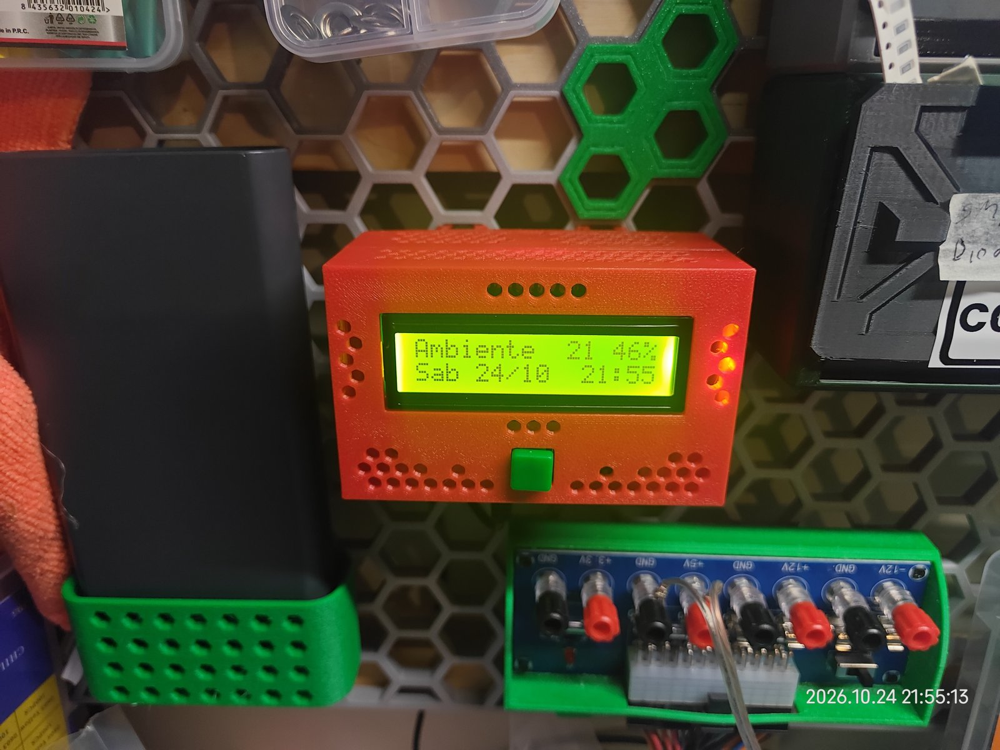
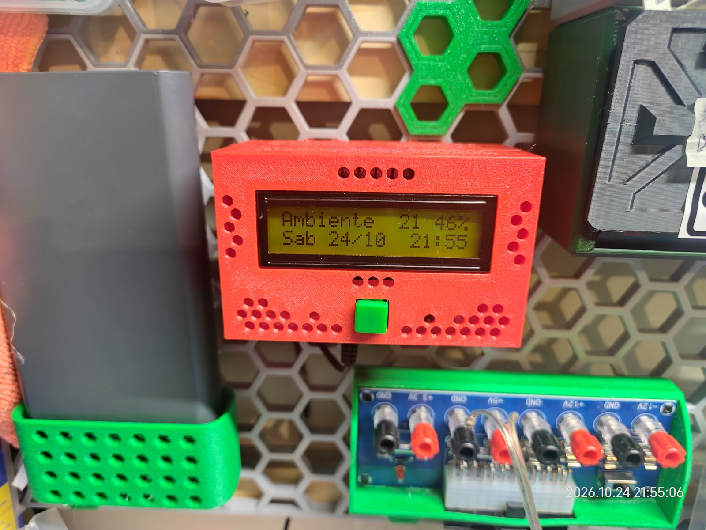

# Temp/TH tester — Wemos D1 mini

Monitor de temperatura y humedad para pared HSW (honeycomb storage wall). Funciona con un **Wemos D1 mini (ESP8266) y ESPHome**, que reporta a Home Assistant. Al frente tiene un **LCD 16×2** con un botón para encender la luz de la pantalla. La carcasa se diseñó en **CadQuery** y se imprime en **PETG** en una Bambu Lab P1S.

Mide en 2 puntos:
- **Ambiente:** BME280 dentro de la carcasa, separado del calor del Wemos. Dirección I2C 0x76.
- **Caja de filamentos:** BME280 remoto conectado por CAT6, dirección 0x77. *Pendiente:* por ahora solo funciona el sensor de ambiente.

| Luz encendida | Luz apagada |
|---|---|
|  |  |

## Estado (2026-10-27)

- **Carcasa terminada y colgada en la pared HSW.** Todo cabe, el USB entra bien y el firmware v2 funciona: Home Assistant ve el dispositivo y la luz de la pantalla se apaga sola a los 30 s.
- Tres días de prueba continua: la humedad coincide con otros medidores y la temperatura difiere ~1 °C (sin offset).
- En la pantalla: la lectura de ambiente arriba y la fecha y la hora abajo (firmware v2, mientras no haya sensor remoto).
- Pendiente: más adelante, la cápsula del sensor remoto.

## Carcasa

Medidas exteriores: **96 × 60 × 49.5 mm**, más 14.6 mm de los conectores HSW. Son 3 piezas:

| Pieza | STL vigente | Orientación de impresión | Qué lleva |
|---|---|---|---|
| Tapa trasera | `tapa_trasera_3` | De pie, con los conectores sobre la cama | 2 conectores HSW integrados a 40.88 mm y 4 barrenos avellanados (juego B) |
| Caja trasera | `caja_trasera_4` | Acostada sobre la pared divisoria | Placa de 50 × 50 con el Wemos, salida del USB abajo, muesca del CAT6 arriba y rejillas que funcionan como chimenea |
| Caja delantera | `caja_delantera_6` | Boca abajo, con el frente sobre la cama | LCD con el marco a ras, botón con clip, BME de ambiente y rejillas hexagonales |

- **Unión de las piezas:**
  - Juego A (caja delantera ↔ caja trasera): 4 M3×8, atornillados desde dentro de la caja trasera.
  - Juego B (tapa ↔ caja trasera): 4 M3×8, con las cabezas del lado de la pared.

  Primero se arma todo sobre la mesa y después se encaja en la rejilla.
- **Impresión:** la cama completa está en [`externalfiles/3mfs/carcasa_completa_1.3mf`](externalfiles/3mfs/carcasa_completa_1.3mf), con las 3 piezas en una sola placa. Configuración: PETG rojo, capas de 0.2 mm, 4 perímetros, relleno grid al 7 %, sin soportes, brim automático.
- **Insertos:** el mapa de qué inserto y qué tornillo va en cada hueco se genera en `output/insertos_caja_*.png`.
- **Ensamble de revisión (STEP):** [`output/ensamble_16.step`](output/ensamble_16.step).

## Electrónica

| Señal | Pin del Wemos |
|---|---|
| Bus de sensores SDA / SCL | D1 / D2 (así quedó soldada la placa) |
| Bus del LCD SDA / SCL (bus aparte, 0x27) | D6 / D5 |
| Botón (a GND, pull-up interno) | D7 |

Firmware: [`esphome/bmetesting_2.yaml`](esphome/bmetesting_2.yaml). Las credenciales del WiFi van en un `secrets.yaml` que no está en el repo. La pantalla se enciende al arrancar o con el botón, y se apaga sola a los 30 s.

## BOM

**Electrónica**

| Cant. | Componente | Nota |
|---|---|---|
| 1 | Wemos D1 mini (ESP8266) | Cables soldados directo, sin tiras de pines |
| 1 | Placa perforada de 50 × 50 × 1 mm | 4 barrenos de Ø2.95 a 45.17 mm entre centros |
| 1 | LCD 1602 con módulo I2C PCF8574 | Pines del I2C doblados hacia atrás |
| 1 | Cable Dupont hembra de 4 hilos | Del LCD a la placa |
| 1 | Botón táctil de 12 × 12 mm, momentáneo | Fijado con clip, sin pegamento |
| 1 | Módulo GY-BME280 (ambiente) | Dirección 0x76; con su propio cable al cabezal de la placa |
| 1 | Cabezal hembra de 8 pines | En la placa, para el BME de ambiente |
| 1 | Cable micro-USB y cargador de 5 V / 1 A | Alimentación |
| — | Cable delgado de 26–28 AWG y termofil | Conexiones |

**Sensor remoto (pendiente)**

| Cant. | Componente | Nota |
|---|---|---|
| 1 | Módulo GY-BME280 (filamentos) | Dirección 0x77 |
| 1 | CAT6 de 1–1.5 m | SDA y SCL en pares distintos |
| 1 | Bornera de 4 polos | Solo en la cápsula |
| 1 | Conector de 90° de 6 pines | En la placa, del lado opuesto al USB |

**Tornillería**

| Cant. | Pieza | Dónde |
|---|---|---|
| 8 | Inserto térmico M3 × 4 × 4.2 | 4 en las columnas de la caja delantera (juego A) y 4 en las de la caja trasera (juego B) |
| 8 | Tornillo M3 × 8 de cabeza cónica | 4 del juego A y 4 del juego B |
| 8 | Inserto térmico M2.5 × 4 × 3.5 | 4 en los postes del LCD y 4 en los postes de la placa |
| 8 | Tornillo M2.5 × 6 | 4 para el LCD y 4 para la placa |

**Material**

| Material | Nota |
|---|---|
| PETG rojo | Las 3 piezas en una cama |
| Silicón | Una gota sobre los pines del BME, para fijarlo |

## Qué se hizo

1. **Brief y arquitectura (2026-09-25).** Se eligió el montaje en pared HSW, 3 piezas y el BME de ambiente separado del calor del Wemos. Se decidió llevar el I2C directo por CAT6 (unos 85 pF, lejos del límite de 400 pF).
2. **Tapa de prueba (2026-09-25 → 10-14).** Se clonó en paramétrico el conector HSW de resorte y se validó con una tapa de prueba: 2 conectores en la misma fila, a ras del borde superior.
3. **Armado eléctrico y medición (2026-10-13 → 10-14).** Se armó la placa de 50 × 50 con el Wemos y se midieron los componentes reales para modelar la caja con cotas reales en vez de nominales.
4. **Distribución y pruebas (2026-10-14 → 10-16).**
   - Se hicieron piezas de prueba del frente y del botón. El clip quedó con ceja de 0.70 y brazo de 0.6: con más ceja el brazo se rompía.
   - La carcasa se compactó a 96 × 60 para que cupiera en un espacio de 100 mm.
   - Los postes del LCD quedaron en cono.
   - Se agregaron rejillas hexagonales y la chimenea en la caja trasera.
5. **Armado (2026-10-16).**
   - Se armaron y probaron las cajas delantera y trasera.
   - Se agregó el avellanado de los barrenos de la tapa.
   - Se registraron las lecciones aprendidas.

El detalle de cada decisión (D-01 a D-32) está en [`docs/superpowers/specs/2026-09-25-carcasa-monitor-design.md`](docs/superpowers/specs/2026-09-25-carcasa-monitor-design.md). El historial día por día y las lecciones aprendidas están en [`docs/bitacora.md`](docs/bitacora.md).

## Lecciones para la próxima

- **Menos tornillería.** Para fijar la placa bastaban 2 pines en diagonal y 2 tornillos. Para las uniones bastaban un labio o chaflán que alinee, 2 pines cruzados y 2 tornillos.
- **El labio de alineación entre cajas va desde la primera versión.**
- **Pensar el acabado desde el principio:** esquinas redondeadas, chaflanes y quizá fuzzy skin.
- **Confirmar el tipo de cabeza del tornillo antes de modelar los barrenos.**

## Estructura

- `cad/`
  - `parameters.py`: fuente única de las cotas.
  - Una pieza por archivo: `tapa_trasera.py`, `caja_trasera.py` y `caja_delantera.py`.
  - `ensamble.py`: genera el ensamble.
  - `test_*.py`: tests (`cd cad && python3 -m pytest -q`).
- `esphome/`: firmware.
- `docs/`: bitácora, especificación, planes, guía de armado eléctrico y portafolio.
- `externalfiles/`: brief original y proyectos de Bambu Studio. Los STL de referencia de terceros no se incluyen (ver "Créditos y licencia").
- `output/`: exportaciones versionadas. Solo el ensamble final está en el repo.

Requisitos: Python 3 con cadquery 2.8, numpy, matplotlib y pytest. Sin los STL de referencia, los 2 tests que comparan el conector contra el original se saltan solos.

## Créditos y licencia

- **Diseño propio** (código CadQuery, piezas, firmware y documentación): licencia [MIT](LICENSE). Úsalo, modifícalo y mejóralo con libertad.
- **Conector HSW de resorte:** `cad/hsw_connector.py` es una reinterpretación paramétrica de un conector de **autor desconocido** (la pieza original trae unas letras en la cara trasera, al parecer "XYZ"). Todos los derechos del diseño original son de su autor; esta reinterpretación no los reclama y queda fuera de la licencia MIT. Si eres el autor o sabes quién es, abre un *issue* para darle el crédito o retirar la pieza.
- **Modelos 3D de componentes** (Wemos D1 mini, LCD 1602, PCF8574 y GY-BME280): se usaron solo como referencia de medidas. Son exportaciones de los modelos 3D de la biblioteca de [EasyEDA](https://easyeda.com) y no se incluyen aquí; se pueden descargar de esa biblioteca.
- **Pared HSW (Honeycomb Storage Wall):** su modelo se usó solo como referencia para el ajuste y no se incluye. HSW es un sistema de terceros.
